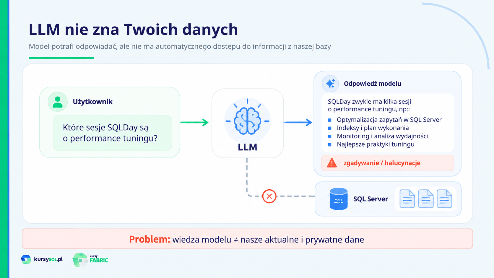
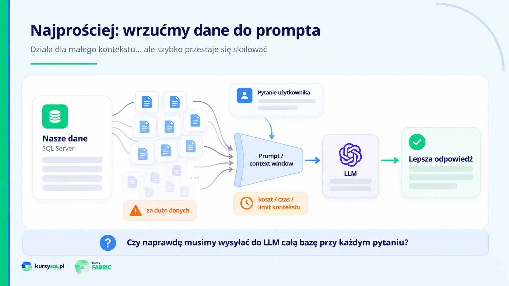
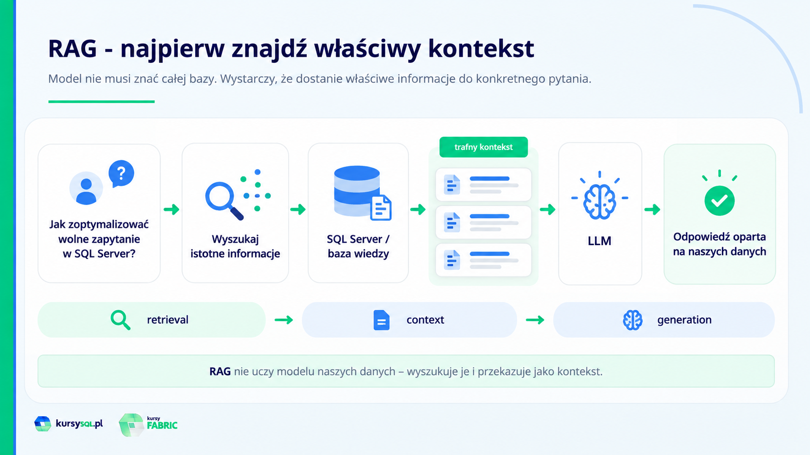
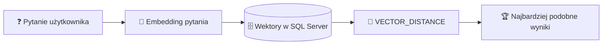
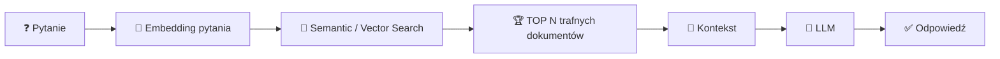

<a href="https://www.kursysql.pl"></a>

# 🤖 AI-ready SQL Server 2025 - LIVE

> **Embeddingi • VECTOR • Semantic Search • RAG • lokalna Ollama**

Materiały do spotkania LIVE poświęconego wykorzystaniu nowych możliwości AI w **SQL Server 2025**.

Celem spotkania nie jest zbudowanie kompletnego rozwiązania od zera. Chcemy przede wszystkim zrozumieć **po co są embeddingi, typ `VECTOR`, wyszukiwanie semantyczne i RAG** oraz zobaczyć kilka najważniejszych elementów w praktyce.

---

## 🧰 Środowisko

Przykłady wykorzystują:

- 🗄️ **SQL Server 2025**,
- 🧪 bazę `SqlDayDemo`,
- 🦙 lokalną [Ollama](https://ollama.com/),
- 🧠 model LLM `llama3.2`,
- 🔢 model embeddingowy `all-minilm`,
- 🔌 model embeddingowy zarejestrowany w SQL Server jako `ollama_all_minilm`,
- 🔒 lokalny endpoint Ollama dostępny przez HTTPS: `https://localhost:11435`.

### 🛠️ Przygotowanie środowiska i bazy demo

Jeżeli chcesz odtworzyć środowisko używane podczas LIVE, skorzystaj z poniższych materiałów:

| Krok | Materiał | Do czego służy |
|---:|---|---|
| 1️⃣ | [`sqlserver2025-setup1-ollama.md`](./sqlserver2025-setup1-ollama.md) | instalacja Ollama i przygotowanie lokalnych modeli |
| 2️⃣ | [`sqlserver2025-setup2-ollama-caddy.md`](./sqlserver2025-setup2-ollama-caddy.md) | konfiguracja HTTPS dla Ollama przy użyciu Caddy |
| 3️⃣ | [`sqldaydemo-setup.md`](./sqldaydemo-setup.md) | opis przygotowania bazy `SqlDayDemo` do przykładów AI |
| 4️⃣ | [`db-sqldaydemo-setup.sql`](./db-sqldaydemo-setup.sql) | utworzenie lokalnej bazy `SqlDayDemo` i obiektów używanych podczas LIVE |
| 5️⃣ | [`db-sqldaydemo-setup-azure.sql`](./db-sqldaydemo-setup-azure.sql) | wariant setupu przeznaczony dla Azure SQL |


---

# 🗺️ Plan LIVE

| # | Część | Główna myśl |
|---:|---|---|
| 🧠 1 | AI ma wiedzę, ale nie zna moich danych | LLM nie ma automatycznego dostępu do naszej bazy |
| 📦 2 | Wrzućmy dane do prompta | działa, ale nie skaluje się |
| 🧩 3 | RAG | najpierw znajdź właściwy kontekst |
| 🔢 4 | Embeddingi | znaczenie tekstu zapisane jako wektor |
| 🔎 5 | Semantic search | szukamy znaczenia, nie tylko słów |
| 🤖 6 | LLM + RAG | model odpowiada na podstawie naszych danych |
| 🚀 7 | Jak zrobić to naprawdę? | pełna implementacja krok po kroku |

---

## 🧠 1. AI ma wiedzę, ale nie zna moich danych

Najpierw odwołujemy się z SQL Server bezpośrednio do lokalnego modelu LLM uruchomionego w Ollama.

Pytamy model o konkretne sesje SQLDay. Model potrafi generować odpowiedzi, ale **nie ma automatycznego dostępu do danych znajdujących się w naszej bazie**. Może więc odpowiedzieć ogólnie, przyznać, że nie zna programu konferencji albo zacząć zgadywać.

🧪 Skrypt: [`live1-sql25-ai-ready-llm-bez-moich-danych.sql`](./live1-sql25-ai-ready-llm-bez-moich-danych.sql)

> 🎯 
> LLM może mieć ogromną wiedzę ogólną, ale nie zna automatycznie naszych aktualnych i prywatnych danych.




---

## 📦 2. Najprostszy pomysł: wrzućmy dane do prompta

Skoro model nie zna naszych danych, możemy pobrać dane z SQL Server i dołączyć je do prompta.

Dla małej liczby rekordów takie podejście działa. Problem pojawia się wtedy, gdy danych są tysiące, setki tysięcy albo miliony. Nie chcemy za każdym razem przekazywać do modelu całej bazy wiedzy.

🧪 Skrypt: [`live2-sql25-ai-ready-llm-z-kontekstem.sql`](./live2-sql25-ai-ready-llm-z-kontekstem.sql)

> ❓ 
> Jak znaleźć tylko te dane, które są potrzebne do odpowiedzi na konkretne pytanie?




---

## 🧩 3. RAG - po co właściwie jest cała ta zabawa?

**RAG - Retrieval-Augmented Generation** pozwala połączyć model LLM z własnymi danymi.


> 💡 **RAG nie oznacza trenowania modelu na naszych danych.**  
> Najpierw wyszukujemy informacje potrzebne do odpowiedzi na konkretne pytanie, a następnie przekazujemy je do modelu jako kontekst.

Pozostaje jednak kolejny problem:

> ❓ Jak znaleźć właściwe dane, jeżeli użytkownik używa innych słów niż te zapisane w bazie?



---

## 🔢 4. Embeddingi - znaczenie tekstu zapisane jako wektor

Model embeddingowy zamienia tekst na reprezentację liczbową - **wektor**.

```text
"SQL Server performance tuning"
              ↓
      🧠 model embeddingowy
              ↓
  [0.12, -0.34, 0.56, ...]
```

Dzięki temu możemy porównywać teksty nie tylko na podstawie identycznych słów, ale również na podstawie ich **znaczenia**.

### 🧱 SQL Server 2025 daje nam m.in.

- 🔢 typ danych `VECTOR`,
- 🧠 funkcję `AI_GENERATE_EMBEDDINGS`,
- 🌐 możliwość korzystania z modeli lokalnych lub chmurowych.

🧪 Skrypt: [`live4-sql25-ai-ready-embeddingi.sql`](./live4-sql25-ai-ready-embeddingi.sql)

> 🎯 **Cel tej części**  
> Nie interesuje nas jeszcze cała konfiguracja modelu. Najpierw chcemy zobaczyć efekt: tekst → embedding → możliwość porównania znaczenia.

---

## 🔎 5. Semantic search - szukamy znaczenia, a nie tylko słów

Klasyczne wyszukiwanie przy użyciu `LIKE` lub Full-Text Search opiera się przede wszystkim na tekście i słowach.

Embeddingi pozwalają zadać inne pytanie:

> **Które dokumenty są najbardziej podobne znaczeniowo do pytania użytkownika?**



W przykładzie generujemy embedding pytania i porównujemy go z embeddingami opisów sesji SQLDay przy użyciu `VECTOR_DISTANCE`.

🧪 Skrypt: [`live5-sql25-ai-ready-semantic-search.sql`](./live5-sql25-ai-ready-semantic-search.sql)

> ✨ 
> Trafny dokument nie musi zawierać dokładnie tych samych słów, których użył użytkownik.

---

## 🤖 6. Wracamy do LLM - tym razem z RAG

Teraz łączymy wszystkie elementy w jeden proces:



Najpierw **SQL Server wyszukuje właściwe dane**. Dopiero potem przekazujemy znalezione informacje do modelu językowego.

🧪 Skrypt demonstracyjny: [`live6-sql25-ai-ready-rag.sql`](./live6-sql25-ai-ready-rag.sql)

🔧 Procedura `dbo.AskSQLDay`: [`live7-sql25-ai-ready-asksqlday.sql`](./live7-sql25-ai-ready-asksqlday.sql)

W czasie LIVE skupiamy się na wyniku i przepływie danych. Kod procedury pokazuje, co dzieje się **pod spodem**:

1. 🔢 generowanie embeddingu pytania,
2. 🔎 znalezienie najbardziej podobnych sesji,
3. 📄 przygotowanie kontekstu,
4. ✍️ zbudowanie prompta,
5. 🦙 wywołanie lokalnego modelu `llama3.2`,
6. ✅ zwrócenie odpowiedzi opartej na danych z SQL Server.

---

## 🚀 7. A jak zbudować to naprawdę od początku?

Podczas LIVE pokazujemy ideę i najważniejsze elementy, ale pełne rozwiązanie wymaga jeszcze m.in.:

- 🛠️ przygotowania SQL Server 2025,
- 🦙 konfiguracji Ollama i HTTPS,
- 🧠 rejestracji modeli AI w SQL Server,
- 📄 przygotowania dokumentów do wyszukiwania,
- 🔢 generowania i aktualizacji embeddingów,
- 🗄️ przechowywania danych w typie `VECTOR`,
- 🔎 wyboru sposobu wyszukiwania wektorowego,
- 🧩 budowy pełnego procesu RAG,
- 🌐 obsługi wywołań REST i błędów.

> 🎓 **Te elementy są rozwijane krok po kroku w pełnym szkoleniu.**

---

# 🎓 Pełne szkolenie: SQL Server 2025 - nowe możliwości w praktyce

🔗 **Opis i program szkolenia:**  
https://www.kursysql.pl/szkolenie-sql-server-2025-nowe-mozliwosci-w-praktyce/


## 📚 Co obejmuje szkolenie?

| Moduł | Zakres |
|---|---|
| 🛠️ **1. Wprowadzenie i środowisko** | SQL Server 2025, materiały, Ollama i Caddy |
| 🧾 **2. JSON** | natywny typ JSON, `JSON_VALUE`, `JSON_QUERY`, `OPENJSON`, `JSON_CONTAINS`, JSON Index i wydajność |
| 🌐 **3. External REST API** | `sp_invoke_external_rest_endpoint`, GET/POST, JSON, uwierzytelnianie i integracje |
| 🤖 **4. SQL AI** | LLM, embeddingi, `VECTOR`, `AI_GENERATE_EMBEDDINGS`, semantic/vector search i RAG |
| 🔤 **5. REGEX** | natywna obsługa wyrażeń regularnych w T-SQL |
| ⚙️ **6. Nowości T-SQL** | Fuzzy String Matching, `||`, `UNISTR`, `PRODUCT`, `CURRENT_DATE`, Base64 |
| 📡 **7. Change Event Streaming** | przesyłanie zmian do Azure Event Hubs i Microsoft Fabric |

### ✅ W ramach szkolenia

- 🎬 **7 modułów**,
- ⏱️ około **7 godzin nagrań video**,
- 🧪 **zadania praktyczne**,
- 💻 dostęp do **skryptów**,
- ♾️ **dostęp dożywotni**.

---

## 💰 Przedsprzedaż - stan na LIVE 14.10.2026

Cena na stronie szkolenia: **450 zł brutto**.

**Kod rabatowy** (ważny do 15 października 2026 włącznie):

```text
SQLSERVER200
```

obniża cenę w przedsprzedaży o **200 zł**.

📅 Premiera całego szkolenia planowana jest na **listopad 2026**.  
🎬 W momencie LIVE dostępne są już moduły **JSON, External REST API i SQL AI**.

---
Tomasz Libera

[libera@kursysql.pl](libera@kursysql.pl)


<a href="https://www.kursysql.pl"></a>
